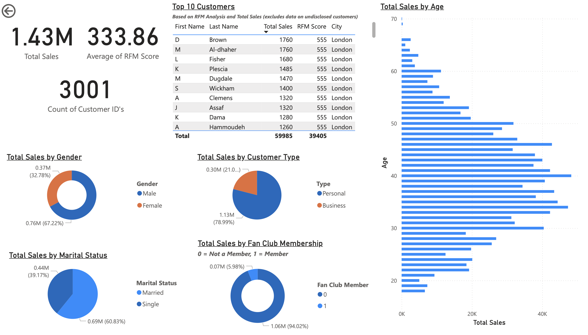

# London Jets: Customer Value and Sales Segmentation

**Business question:** Who are London Jets' most valuable customers, and which segments drive sales?

## Overview
- **Tool:** Power BI
- **Data:** customer and sales dataset covering 3,001 customers
- **Context:** EMBA group project, MIS course, MDI Gurgaon

## My contribution
I designed and built the dashboard visuals: KPI cards, a top-customer table with RFM scores, and segment breakdowns. A teammate handled the data cleaning.

## Key insights
1. Personal customers account for about 79% of sales, against 21% from business customers.
2. Fan club members contribute only about 6% of sales, which points to a loyalty and upsell opportunity.
3. Sales cluster among buyers aged roughly 30 to 50, and nine of the top ten customers by sales are London-based.

## Files
- `London_Jets_Dashboard.pdf`: full dashboard export
- `London_Jets_Dashboard.png`: dashboard screenshot
